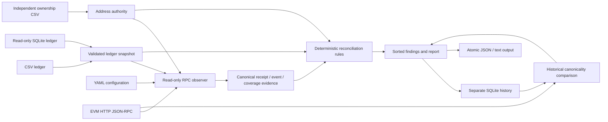

# Architecture

`internal/domain` defines lossless string amounts, identity validation, observations and reports. `internal/config` strictly decodes one YAML document, supplies bounded defaults and validates before networking. `internal/ledger` normalizes CSV/SQLite to the same entries and independently loads owners. CSV errors identify the row; SQLite errors identify the entry.

`internal/chain.Reader` is a narrow domain interface implemented by a go-ethereum adapter. It exposes chain ID, headers, receipts and recipient-filtered logs, with no wallet methods. Receipt retrieval is concurrent, cached by unique hash and bounded; header verification and log chunks are sequential. RPC attempts use per-request deadlines and finite transient retries. The observer fixes a reference head, validates receipt/log identities, compares canonical hashes and repeats header checks. Discovery responses must agree with independent receipts.

`internal/reconcile` is I/O-free: prepared entries, ownership, evidence and policy produce sorted findings. Explicit indices identify events first; attribute selection requires uniqueness. Credit claims and valid consumption are separate, so a duplicate or invalid attribution cannot hide behind the chain-to-ledger pass. Unidentified expected records expose candidates without assigning identity.

`internal/app` coordinates the CLI, cancellation, separate history, reporting and exit status. It rejects aliases between input, history and report paths, including existing hard links and symlinks. `internal/report` serializes evidence or produces detailed text. A temporary report is fsynced, closed and renamed into place.

`internal/storage` uses its own SQLite transaction migration (`user_version=1` and an application identifier). An unrecognized nonempty database is never migrated. Every run archive retains classifications and snapshots; event observations are upserted by chain/token/event/block-hash, preserving prior block assignments. Only canonical successful observations from consistent chain views are retained as history. The database has no pruning daemon; rotate it according to local retention policy. A loaded scope over 100,000 observations fails rather than silently truncating.

Source SQLite opens with `mode=ro` and issues SELECTs only. No source migration or automatic financial correction exists. History and report writes are independent operations: a report write failure can leave a stored run archive. Such a failure exits 2. The fixture broadcaster lives outside production packages in `script/demo.py` and only connects to the temporary localhost Anvil process it starts.
